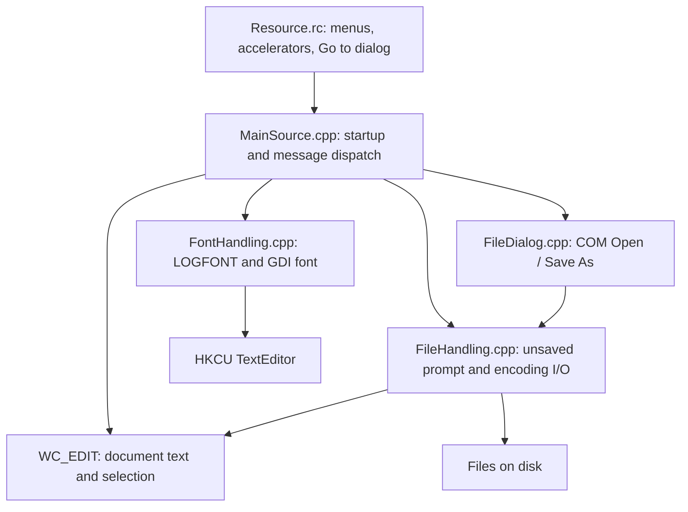

# Architecture

## Application shape

This is a procedural, event-driven Win32 desktop application. One process owns one main window and one document. The standard `WC_EDIT` multiline control owns the editable UTF-16 text and undo state. There is no separate document model, controller class, background worker, or persistence service.

## Source map

| File | Responsibility |
| --- | --- |
| `Text Editor/MainSource.cpp` | `wWinMain`, global state, window creation, message loop, menu dispatch, edit subclass, Go to, find/replace, drag/drop, layout, wrap, zoom, and status updates. |
| `Text Editor/FileHandling.cpp` | Unsaved-change callback gate; whole-file binary reads; encoding detection and conversion; writes from edit-control text. |
| `Text Editor/FileDialog.cpp` | COM initialization and native Open / Save As dialogs with custom encoding combo boxes; updates the active path and calls file I/O. |
| `Text Editor/FontHandling.cpp` | Default font values, individual registry field reads/writes, and GDI font creation. |
| `Text Editor/ProgramHeader.h` | Shared constants, global declarations, callback type, and cross-module function contracts. |
| `Text Editor/pch.h`, `pch.cpp` | Common Windows/C++ includes and a common-controls v6 manifest directive. Despite the name, no precompiled-header mode is configured in the project. |
| `Text Editor/Resource.rc`, `resource.h` | Menus, keyboard accelerators, Go to dialog layout, and numeric resource identifiers. |
| `Text Editor.sln`, `Text Editor.vcxproj`, `.filters` | Visual Studio configurations, compile/link settings, and IDE file grouping. |

## Startup and messages

`wWinMain` initializes flags and encoding, creates or opens the font registry key, initializes common controls, registers the find/replace notification message, and creates the main window. `WM_CREATE` calls `InitProgram` to create the path field, editor, status bar, find/replace state, and fonts. Startup then applies edit defaults, loads accelerators, and attempts to open a command-line path.

The UI thread runs `GetMessageW`, with accelerators and modeless find/replace dialog handling before normal translation/dispatch. `WindowProc` routes menu commands and window events. `EditControlProc` first delegates to `DefSubclassProc`, then updates caret/selection menu state and zoom feedback for selected messages. Closing goes through the unsaved-change gate, optionally persists the font, destroys the window, and posts quit. Startup and final shutdown use `ExitProcess`.

All reading, writing, conversion, and searching run synchronously on this UI thread. Large files and long searches therefore block input and repainting.

## Shared state

| State | Meaning and lifetime |
| --- | --- |
| `fileName` | Active path; expected to be null for an untitled document. Dialog/drop paths use COM task memory, while the startup path incorrectly borrows an `argv` entry. |
| `encoding` | Selected/detected encoding ID; initially `ENCODING_AUTO_FIND`. Shared by dialogs, readers, and writers. |
| `haveUnsaved` | Dirty flag, set by `EN_CHANGE`; updates from programmatic text replacement are not consistently distinguished from user edits. |
| `hWndMain`, `hMainEdit`, `hDirEdit`, `hStatus` | Global window/control handles. Word wrap destroys and replaces `hMainEdit`. |
| `lf`, `hMainEditFont`, `hDirEditFont`, `fontChanged` | Font description, GDI font handles, and persistence flag. |
| `fr`, `findWhat`, `replaceWith`, `hFindText`, `idFindMsg` | Persistent buffers and state used by modeless common find/replace dialogs. |
| `isVisibleStatBar`, `nGotoChInd` | Layout preference and the character offset returned by Go to. |

Most cross-module state is declared `extern` in `ProgramHeader.h` and defined in `MainSource.cpp`; other UI state is defined only in that source file. This couples file persistence directly to the UI and makes isolated testing difficult.

## Document flows

**Open:** menu/drop actions call `ExecuteHandleUnsaved`. After the prompt, a dialog or drop callback installs a path and encoding. `OpenWorkingFile` reads the whole file plus four trailing zero bytes, detects encoding when requested, and loads UTF-16 text into the control. It updates the path, Save menu state, and encoding/line-ending labels. UTF-8 loading also applies NFC normalization.

**Save:** `SaveWorkingFile` copies the control text, opens the current path with truncation, and serializes according to `encoding`. Save As first obtains a new path and encoding via COM. File writes return no status; dialog success does not prove successful persistence. Ordinary Save does not reset `haveUnsaved`.

**Unsaved changes:** `ExecuteHandleUnsaved` accepts a function pointer and `LPARAM` context. It prompts when dirty, optionally saves, invokes the callback unless canceled, and then clears the flag in the dirty branch. Its `LRESULT` cannot distinguish all cancellation and success cases. New clears visible text and labels but does not reset the underlying path or encoding.

**Find/replace:** the registered common-dialog message routes to `FindReplaceProc`, which locks the edit control's local text handle. Find searches with case-sensitive or insensitive Shlwapi string functions; Replace edits the selection; Replace All builds a separate buffer. The locked buffer must remain valid across these operations, which the current Replace path does not ensure.

## Resource ownership

- Windows owns control text buffers; the application temporarily accesses them through `EM_GETHANDLE` and `LocalLock`.
- File/conversion buffers use manual `new[]` / `delete[]`; exceptions can bypass cleanup.
- Dialog interfaces use manual `Release`; each successful `CoInitializeEx` is balanced with `CoUninitialize`.
- Dialog result paths and drop paths use `CoTaskMemFree`; command-line storage requires a different ownership strategy.
- GDI fonts need `DeleteObject`. Font replacement deletes the previous editor font, but final shutdown does not explicitly release all font/path resources.
- Drop handles are released with `DragFinish`, and registry keys with `RegCloseKey`.

These are descriptions of the current implementation. Proposed improvements and defects are tracked in [current problems](KNOWN_ISSUES.md), rather than implied by the diagram as existing abstractions.
